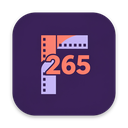
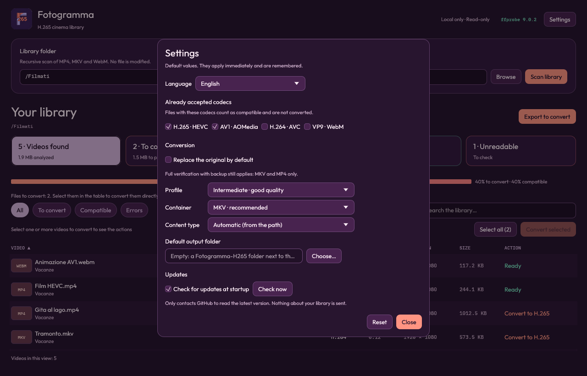
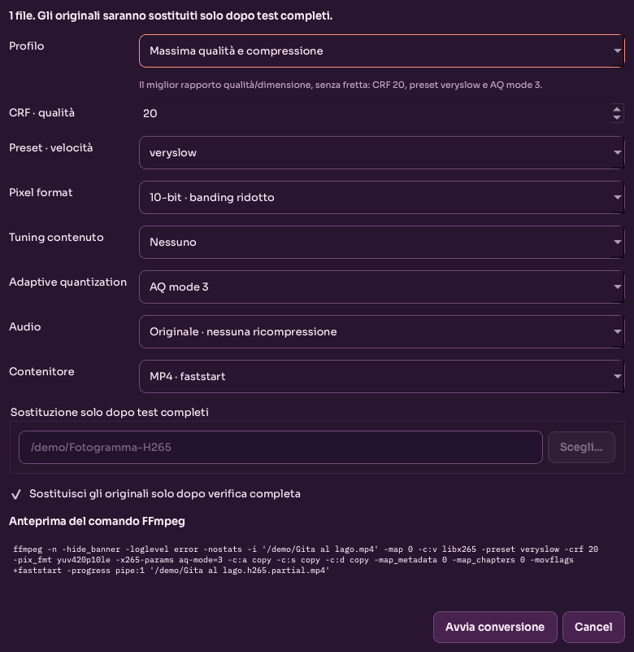

<h1>
  
  Fotogramma
</h1>

[](https://github.com/JohnnyTaxs/fotogramma/releases/latest)
[](https://github.com/JohnnyTaxs/fotogramma/actions/workflows/build-release.yml)
[](LICENSE)

Fotogramma is a **native desktop application** for inspecting a video library, identifying files that may benefit from H.265 conversion, and converting videos directly with FFmpeg.

It is written in **Rust** with `egui`/`eframe` and renders with OpenGL: no browser, WebView, HTTP server, or launcher. The interface is available in **English and Italian**: it follows the operating system language and can be overridden in Settings. The Python 1.x application has been removed; the repository contains only the Rust workspace.


> **Personal project:** Fotogramma was created primarily for my own use. It is shared in the hope that it may also be useful to others. **It is provided “AS IS”, without any warranty of any kind, express or implied, including but not limited to correctness, reliability, fitness for a particular purpose, non-infringement, availability, security, or data integrity. Use it at your own risk. You are solely responsible for backups and for validating converted or replaced files.**

## Why Fotogramma exists

Many tools already transcode video, from HandBrake to automated library transcoders such as Tdarr or Unmanic. Fotogramma does not try to replace them. It exists for two things they do not do the way I wanted:

- **Control over each transcode.** Automated, bulk-oriented tools decide for you and run through the whole library on their own, which is the right trade-off for some setups and the wrong one when you care about individual files. Here you pick the files, the preset (or every x265 parameter), the content type, the audio, the container, and where the result goes, and you see the exact FFmpeg command before it runs. Nothing is converted unless you start it, originals are never overwritten by default, and replacing one is an explicit, fully verified step with a backup.
- **Finding what is not H.265 yet, fast, in a huge library.** Scanning reads only the first video stream with `ffprobe`, so a library of thousands of files is sorted into *to convert*, *already compatible*, and *unreadable* in one pass, with filters, search, and sorting to isolate the leftovers (the old H.264 episodes that slipped past, one folder, one show).

It is a small native desktop app, not a service: no server, no database, no account, nothing to deploy next to your media stack.

## Features

- Native desktop window for macOS, Windows, and Linux.
- Recursive discovery of `.mp4`, `.mkv`, and `.webm` files.
- Clear grouping into **to convert**, **already compatible** (HEVC and AV1 by default), and **unreadable** files.
- Statistics, filters, search, sortable columns, and multi-file selection, with a **Select all** button for everything convertible in the current view.
- **Convert selected** runs FFmpeg directly with readable presets and a custom mode.
- Full-output validation before replacing an original file.
- **Space saved:** each converted file shows its new size against the old one, and the end of a conversion reports the total space freed (or used, if a file grew).
- **Content type:** anime or live action (films and series). Anime gets `-tune animation`; "Automatic" reads the folders of the path (`Anime`, `Film`, `Serie TV`, `Movies`…), in English and Italian.
- **Self-update:** the app checks GitHub at startup, shows the release notes, and installs the new version after verifying its checksum. It can be switched off.
- **English and Italian**, chosen automatically from the system language, with an optional manual override.
- **Settings** window: choose which codecs count as already compatible (the home page, statistics, and table update at once, no new scan) and the conversion defaults (replace original, profile, container).
- Original application icon and Cinema Pop theme.
- No videos are modified during inspection. No media or metadata is uploaded during scanning or conversion.

## Size

The portable archives are an order of magnitude smaller than the Qt/Python 1.x builds they replaced:

| Platform | Application | ZIP |
| --- | --- | --- |
| macOS ARM | 23.6 MB | 10.9 MB (DMG 12.7 MB) |
| Linux x86_64 | 40.3 MB | 13.3 MB |
| Windows amd64 | 35.4 MB | 11.1 MB |

The macOS build went from 106 MB and a 44 MB ZIP in 1.0.4 to 23.6 MB and 10.9 MB. The Linux and Windows bundles are larger because x265's x86 assembly is about twice the size of the arm64 build, and the C++ runtime travels inside that library instead of as a separate file.

The bundle contains the Rust binary, the original icon, and a purpose-built FFmpeg with only the containers, codecs, and filters the app uses. CI fails the build if the application exceeds 45 MB or the ZIP exceeds 18 MB.

## Settings



Open **Settings** (*Impostazioni* in Italian) from the header. Changes apply immediately and are remembered:

- **Language:** automatic (follows the system), Italian, or English.
- **Accepted codecs:** H.265, AV1, H.264, VP9. Files with an accepted codec count as already compatible. Unreadable files always stay errors, and a conversion is always verified as HEVC.
- **Content type:** automatic (from the path), anime, or films and series, used as the default in the conversion dialog.
- **Default output folder:** where converted files go. Empty means a `Fotogramma-H265` folder next to the originals.
- **Replace the original by default:** pre-selects the verified replacement in the conversion dialog.
- **Profile and container:** the preset and `mkv`/`mp4` pre-selected for new conversions.

## Conversion presets



| Preset | Intended use | Video settings | Default audio |
| --- | --- | --- | --- |
| Maximum quality and compression | Best quality/size ratio, even if slow | CRF 20, `veryslow`, AQ mode 3, 10-bit | Original |
| Intermediate · good quality | Balanced quality, size, and speed | CRF 22, `medium`, 10-bit | Original |
| Fast · quick transcode | Maximum transcoding speed | CRF 26, `ultrafast`, 8-bit | Original |
| Custom | Manual control | CRF, preset, pixel format, tune (none, animation, grain), AQ mode | Original or AAC |

### Content type

Besides the quality preset, the conversion dialog has a **Content type** menu:

| Choice | Encoder effect |
| --- | --- |
| Automatic (from the path) | Anime if any folder of the path says so, films and series if one says that, otherwise standard settings. The dialog shows what it detected. |
| Anime / animation | `-tune animation`: flat areas and sharp lines are kept without wasting bits. |
| Films and TV series | No tune: x265's own defaults are already made for live action. (x265 has no `film` tune.) |

The words it looks for in folder names are `anime`, `animazione`, `animation`, `cartoni`, `cartoon` for anime and `film`, `movie(s)`, `serie`, `series`, `tv`, `telefilm`, `show(s)`, `documentari`, `documentary` for live action. Anime wins when both appear, so `Anime/Film/` and `Anime/Frieren The Movie/` stay anime. Only whole words count (`Filmati` does not match) and the file name is ignored. With a mixed selection nothing is guessed. The audio choice (original or AAC 128/160/256 kbps) applies to every preset.

All streams are mapped with `-map 0`, preserving audio tracks, subtitles, chapters, and compatible metadata. Audio can be kept unchanged or encoded as **AAC 128/160/256 kbps**. MKV is recommended for stream compatibility; MP4 enables `+faststart`.

The default output is a new `.h265.mkv` or `.h265.mp4` file with a numeric suffix if needed. **Originals are never overwritten in the default mode.**

## Verified original replacement

**Replace originals only after full validation** is an explicit option, disabled unless you turn it on in the conversion dialog or make it the default in Settings. When enabled, Fotogramma writes a `.partial` file next to the original and replaces it only after all checks pass:

1. Output codec is HEVC.
2. Duration matches within 1% or 1 second.
3. Audio, video, subtitle, and data stream counts match.
4. Full decode succeeds with `ffmpeg -v error -i output -f null -`.
5. The replacement passes a final codec check before the temporary backup is deleted.

If any check fails, the original remains unchanged. Replacement uses an atomic rename on the same filesystem and a `.fotogramma-backup` file that is removed only after success. The container must match the original extension (MKV or MP4); WebM replacement is not supported.

## Requirements

| Platform | Package | Needs |
| --- | --- | --- |
| macOS | Apple Silicon (arm64) only | **macOS 15 or later.** The bundled FFmpeg and x265 are built on a macOS 15 runner. |
| Windows | x86-64 | 64-bit Windows 10 or later. |
| Linux | x86-64 | A recent distribution: the package is built on Ubuntu 24.04, so it needs glibc 2.39 or newer. |

There is no macOS Intel build. Each package carries its own `ffmpeg` and `ffprobe`, so nothing else has to be installed.

## Known limitations

These are choices, not oversights:

- **Software encoding only (x265), no hardware acceleration.** Hardware encoders (VideoToolbox, NVENC, QuickSync, AMF) are much faster but give a worse quality for the same size. Fotogramma is about getting the best H.265 out of a file, so it does not offer them and there is no plan to.
- **One conversion at a time.** The queue is sequential on purpose: x265 already uses every core, and parallel jobs only saturate the CPU and the disk.
- **Only the first video stream is analyzed** (`v:0`) of `.mp4`, `.mkv`, and `.webm`. A file with several video streams is classified by its first one; the conversion itself keeps every stream (`-map 0`).
- **Replacing an original does not work with WebM.** The WebM container only allows VP8, VP9 and AV1 video, so an HEVC result cannot stay a `.webm`: it has to become `.mkv` or `.mp4`. Replacing means swapping the verified result into the original's exact path with a backup, and a different extension would break that guarantee. WebM files can still be converted: the result is a new `.mkv` or `.mp4` next to them, and the original is left alone.
- **No macOS notarization.** The app is ad-hoc signed but not notarized (that needs a paid Apple developer account), so Gatekeeper asks you to confirm the first launch.
- **No macOS Intel build,** and the interface is available in Italian and English only.

## Run the portable app

The portable build includes the Rust application and its own `ffmpeg`/`ffprobe`; no installation is required on the destination computer. The bundled FFmpeg is built with `--enable-gpl` and x265, so the package includes GPL v2 or later code (see [Privacy and license](#privacy-and-license)); Fotogramma's own source stays MIT.

For macOS Apple Silicon, download `Fotogramma-Darwin-arm64.dmg` from the [latest release](https://github.com/JohnnyTaxs/fotogramma/releases/latest), open it, and drag **Fotogramma** onto the **Applications** shortcut. The bundle is ad-hoc signed but not notarized, so Gatekeeper asks for confirmation on first launch: use **System Settings → Privacy & Security → Open Anyway** (on older macOS versions, right-click `Fotogramma.app` → **Open**).

The same release has `Fotogramma-Darwin-arm64.zip` (extract it with Finder, or with `ditto` from a terminal; generic ZIP tools can lose permissions and app-bundle metadata). The ZIP is what the in-app updater installs.

On Windows, run `fotogramma.exe` inside the extracted folder. On Linux, run the `fotogramma` binary with `bin/` and `lib/` beside it. Each package is built on its own operating system: the release is never cross-compiled.

## Updates

At startup Fotogramma asks GitHub for the latest release. If it is newer, a window shows the release notes with **Update and restart**, **Later**, and **Skip this version**. The update:

1. downloads the archive for your system from this repository's release;
2. refuses it unless its SHA-256 matches `SHA256SUMS.txt`, published with every release (and, on macOS, unless the code signature is valid);
3. after you quit, swaps the installed copy for the new one, keeps the old one if anything fails, and starts the new version.

It needs write access to the folder that holds the app; otherwise the window shows the release page to download by hand. A copy started with `cargo run` is never replaced. **Settings → Updates** turns the startup check off or checks right away, and `FOTOGRAMMA_NO_UPDATE_CHECK=1` disables it for a single run. Releases up to 2.3.0 have no updater and no checksums: install 2.4.0 by hand once.

## Run from source

Requirements: a stable Rust toolchain plus `ffmpeg` and `ffprobe` on `PATH` (or set `FOTOGRAMMA_FFMPEG_DIR` to the folder that contains them).

```bash
cargo run --release -p fotogramma
```

Optional arguments:

```bash
# Pre-fill the library directory
cargo run --release -p fotogramma -- --directory /path/to/videos

# Start scanning immediately
cargo run --release -p fotogramma -- \
  --directory /path/to/videos --scan-on-start

# Start, scan, and exit (automated verification)
cargo run --release -p fotogramma -- \
  --directory /path/to/videos --scan-on-start --smoke-test
```

The application looks for the media tools in the executable folder, `bin/` beside it, the macOS `Resources/bin` folder, the working directory, and finally `PATH`.

## Usage

1. Choose a folder with **Browse** (*Sfoglia*) or enter its path.
2. Click **Scan library** (*Analizza libreria*).
3. Use statistics and filters to narrow down candidates.
4. Select one or more videos to reveal available actions, or click **Select all** to take every convertible video in the current view (the filter and the search narrow it; the button then turns into **Clear selection**).
5. Click a column header to sort and double-click a video for details.
6. Convert directly or export the list for another tool.
7. Adjust the language, the accepted codecs, and the conversion defaults in **Settings** (*Impostazioni*).

The last directory, window size, and your settings are saved in `settings.toml` under the platform configuration folder. Scan results are never persisted.

## Tests

```bash
cargo test --workspace
cargo clippy --workspace --all-targets --locked -- -D warnings
```

The suite covers discovery, probing, classification, presets, FFmpeg arguments, output allocation, duration/stream/full-decode validation, atomic replacement and backup restoration, settings, the virtualized table, codec re-classification, language selection and English output, update parsing, checksums, extraction and the swap helper, and four `egui_kittest` snapshots (main window and conversion dialog at 1280×820 and 1050×680).

Two optional end-to-end tests convert a generated clip and verify atomic replacement with real FFmpeg binaries. They use the system tools by default, or the packaged minimal tools when `FOTOGRAMMA_FFMPEG_DIR` is set:

```bash
FOTOGRAMMA_FFMPEG_DIR="$PWD/deployment/vendor/rust/Darwin-arm64/bin" \
  cargo test -p fotogramma-core --test conversion_pipeline
```

## Build

The minimal FFmpeg is built first, then the application is assembled and measured:

```bash
deployment/ffmpeg/build_minimal.sh     # macOS and Linux
python3 deployment/build_rust.py
```

See [`deployment/README.md`](deployment/README.md) for Windows, vendoring rules, and verification steps.

## CI/CD and releases


The GitHub Actions workflow in `.github/workflows/build-release.yml` runs clippy and the tests, builds the minimal FFmpeg, packages the app, and enforces the size budget on **Linux, Windows, and macOS ARM**. macOS Intel is intentionally excluded. On every `v*` tag it publishes or updates a GitHub release containing all portable ZIP files.

Runner and token details are documented in [CI/CD with GitHub Actions](docs/CICD.md).

## Project structure

```text
Cargo.toml                 Workspace, release profile
crates/core/               UI-free engine
  src/scanner.rs           Discovery, ffprobe, classification, cancellation
  src/media_tools.rs       ffmpeg/ffprobe resolution and DYLD environment
  src/conversion.rs        Presets, FFmpeg arguments, safe output allocation
  src/verification.rs      Full validation and atomic backup replacement
  src/update.rs            Release check, verified download, swap helper (only network use)
  src/formatting.rs        Italian number and size formatting
crates/app/                egui/eframe application
  src/app.rs               Window, layout, scan flow, snapshots
  src/icon.rs              Application and Dock icon at startup
  src/table.rs             Virtualized table, filters, sorting, selection
  src/dialogs.rs           Preferences, conversion settings, progress, details, confirmations
  src/worker.rs            Scan and conversion threads with channels
  src/theme.rs             Cinema Pop colors, fonts, visuals
  src/settings.rs          TOML settings (directory, window size, defaults)
  src/platform.rs          Open folder in the system file manager
deployment/
  ffmpeg/                  Minimal FFmpeg build and vendor collectors
  dmg/                     macOS disk image background and its generator
  build_rust.py            Packaging, ZIP, signature round-trip, size budget
  create_release.py        GitHub release uploader
  Fotogramma.icns/.ico/.png
docs/                      Architecture, CI/CD, demo assets, release notes
static/fonts/              Embedded fonts and their licenses
```

## Issues and contributing

This is a personal project, so there is no support promise, but bug reports are welcome on the [issue tracker](https://github.com/JohnnyTaxs/fotogramma/issues). If you want to change the code, [`AGENTS.md`](AGENTS.md) lists the rules the project follows (native desktop only, originals never overwritten by default, both languages for every string, the size budget) and the checks to run before a change.

## Documentation

- [Architecture](docs/ARCHITECTURE.md)
- [Build and distribution](deployment/README.md)
- [CI/CD with GitHub Actions](docs/CICD.md)
- [Agent guide](AGENTS.md)
- [MIT License](LICENSE)

## Privacy and license

The app opens no server and no browser, and your videos and library are never uploaded. The only network request is the update check: one HTTPS request to `api.github.com` at startup (it reveals your IP address and the app version, like any download), which you can turn off in Settings. Scanning and conversion run locally with the bundled FFmpeg.

Fotogramma itself is released under the **MIT License**. See [`LICENSE`](LICENSE) for the full text, including the warranty disclaimer.

The bundled FFmpeg is built with `--enable-gpl --enable-libx265`, so the distributed media toolchain is covered by GPL v2 or later; the corresponding source is FFmpeg 9.0.2 plus x265, and the build flags are published in `deployment/ffmpeg/`. The application source remains MIT.
