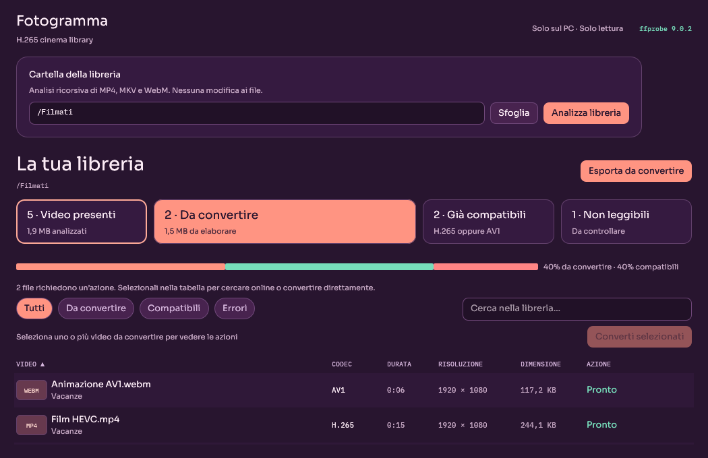

# Fotogramma

Fotogramma is a **native desktop application** for inspecting a video library, identifying files that may benefit from H.265 conversion, searching for an existing H.265 version online, and converting videos directly with FFmpeg.

Version 2 is written in **Rust** with `egui`/`eframe` and renders with OpenGL: no browser, WebView, HTTP server, or launcher.



> **Personal project:** Fotogramma was created primarily for my own use. It is shared in the hope that it may also be useful to others. **It is provided “AS IS”, without any warranty of any kind, express or implied, including but not limited to correctness, reliability, fitness for a particular purpose, non-infringement, availability, security, or data integrity. Use it at your own risk. You are solely responsible for backups and for validating converted or replaced files.**

## Features

- Native desktop window for macOS, Windows, and Linux.
- Recursive discovery of `.mp4`, `.mkv`, and `.webm` files.
- Clear grouping into **to convert**, **already compatible** (HEVC/AV1), and **unreadable** files.
- Statistics, filters, search, sortable columns, and multi-file selection.
- **Find H.265 online** opens a cleaned-up search on 1337x.to in your default browser.
- **Convert selected** runs FFmpeg directly with readable presets and a custom mode.
- Full-output validation before replacing an original file.
- Original application icon and Cinema Pop theme.
- No videos are modified during inspection. No media or metadata is uploaded during scanning or conversion.

## Size

The portable archives are an order of magnitude smaller than the Qt/Python 1.x builds:

| Component | 1.0.4 | 2.0.0 |
| --- | --- | --- |
| macOS application | 106 MB | 22.4 MB |
| macOS ZIP | 44 MB | 10.0 MB |

The bundle contains the Rust binary, the original icon, and a purpose-built FFmpeg with only the containers, codecs, and filters the app uses. CI fails the build if the application exceeds 45 MB or the ZIP exceeds 18 MB.

## Conversion presets

| Preset | Intended use | Video settings | Default audio |
| --- | --- | --- | --- |
| Maximum quality and compression | Best quality/size ratio, even if slow | CRF 20, `veryslow`, AQ mode 3, 10-bit | Original |
| Intermediate · good quality | Balanced quality, size, and speed | CRF 22, `medium`, 10-bit | Original |
| Fast · quick transcode | Maximum transcoding speed | CRF 26, `ultrafast`, 8-bit | Original |
| Custom | Manual control | CRF, preset, pixel format, tune, AQ mode | Original or AAC |

All streams are mapped with `-map 0`, preserving audio tracks, subtitles, chapters, and compatible metadata. Audio can be kept unchanged or encoded as **AAC 128/160/256 kbps**. MKV is recommended for stream compatibility; MP4 enables `+faststart`.

The default output is a new `.h265.mkv` or `.h265.mp4` file with a numeric suffix if needed. **Originals are never overwritten in the default mode.**

## Verified original replacement

**Replace originals only after full validation** is an explicit, disabled-by-default option. When enabled, Fotogramma writes a `.partial` file next to the original and replaces it only after all checks pass:

1. Output codec is HEVC.
2. Duration matches within 1% or 1 second.
3. Audio, video, subtitle, and data stream counts match.
4. Full decode succeeds with `ffmpeg -v error -i output -f null -`.
5. The replacement passes a final codec check before the temporary backup is deleted.

If any check fails, the original remains unchanged. Replacement uses an atomic rename on the same filesystem and a `.fotogramma-backup` file that is removed only after success. The container must match the original extension (MKV or MP4); WebM replacement is not supported.

## Online search

Select one convertible video and choose **Find H.265 online**. Fotogramma opens `https://1337x.to/search/<title+H.265>/1/` in your default browser.

No content is downloaded, no torrent client is integrated, and no WebView is embedded. Common release tags are removed from the title to improve search results. A query is sent outside your computer only when you explicitly choose this action.

## Run the portable app

The portable build includes the Rust application and its own `ffmpeg`/`ffprobe`; no installation is required on the destination computer.

For macOS Apple Silicon, download `Fotogramma-Darwin-arm64.zip` from the [latest release](https://github.com/JohnnyTaxs/fotogramma/releases/latest), then extract it with Finder (double-click). The bundle is ad-hoc signed but not notarized, so Gatekeeper asks for confirmation on first launch: use **System Settings → Privacy & Security → Open Anyway** (on older macOS versions, right-click `Fotogramma.app` → **Open**).

Use `ditto` when extracting from a terminal; generic ZIP tools can lose permissions and app-bundle metadata. The build script creates and verifies the archive with `ditto` and `codesign`.

On Windows, run `fotogramma.exe` inside the extracted folder. On Linux, run the `fotogramma` binary with `bin/` and `lib/` beside it. Each package is built on its own operating system: the release is never cross-compiled.

## Run from source

Requirements: a stable Rust toolchain plus `ffmpeg` and `ffprobe` on `PATH` (or set `FOTOGRAMMA_FFMPEG_DIR` to the folder that contains them).

```bash
cd rust
cargo run --release -p fotogramma
```

Optional arguments:

```bash
# Pre-fill the library directory
cargo run --release -p fotogramma -- --directory /path/to/videos

# Start scanning immediately
cargo run --release -p fotogramma -- \
  --directory /path/to/videos --scan-on-start

# Start, scan, and exit (automated verification)
cargo run --release -p fotogramma -- \
  --directory /path/to/videos --scan-on-start --smoke-test
```

The application looks for the media tools in the executable folder, `bin/` beside it, the macOS `Resources/bin` folder, the working directory, and finally `PATH`.

## Usage

1. Choose a folder with **Browse** or enter its path.
2. Click **Analyze library**.
3. Use statistics and filters to narrow down candidates.
4. Select one or more videos to reveal available actions.
5. Click a column header to sort and double-click a video for details.
6. Convert directly or export the list for another tool.

The last directory and window size are saved in `settings.toml` under the platform configuration folder. Scan results are never persisted.

## Tests

```bash
cd rust
cargo test --workspace
```

The suite covers discovery, probing, classification, presets, FFmpeg arguments, output allocation, duration/stream/full-decode validation, atomic replacement and backup restoration, settings, search URLs, the virtualized table, and four `egui_kittest` snapshots (main window and conversion dialog at 1280×820 and 1050×680).

Two optional end-to-end tests convert a generated clip and verify atomic replacement with real FFmpeg binaries. They use the system tools by default, or the packaged minimal tools when `FOTOGRAMMA_FFMPEG_DIR` is set:

```bash
FOTOGRAMMA_FFMPEG_DIR="$PWD/deployment/vendor/rust/Darwin-arm64/bin" \
  cargo test -p fotogramma-core --test conversion_pipeline
```

## Build

The minimal FFmpeg is built first, then the application is assembled and measured:

```bash
deployment/ffmpeg/build_minimal.sh     # macOS and Linux
python3 deployment/build_rust.py
```

See [`deployment/README.md`](deployment/README.md) for Windows, vendoring rules, and verification steps.

## CI/CD and releases


The GitHub Actions workflow in `.github/workflows/build-release.yml` runs tests, builds the minimal FFmpeg, packages the app, and enforces the size budget on **Linux, Windows, and macOS ARM**. macOS Intel is intentionally excluded. On every `v*` tag it publishes or updates a GitHub release containing all portable ZIP files.

Runner and token details are documented in [CI/CD with GitHub Actions](docs/CICD.md).

## Project structure

```text
rust/
  Cargo.toml               Workspace, release profile
  crates/core/             UI-free engine
    src/scanner.rs         Discovery, ffprobe, classification, cancellation
    src/media_tools.rs     ffmpeg/ffprobe resolution and DYLD environment
    src/conversion.rs      Presets, FFmpeg arguments, safe output allocation
    src/verification.rs    Full validation and atomic backup replacement
    src/search.rs          Title cleanup and external 1337x.to URLs
    src/formatting.rs      Italian number and size formatting
  crates/app/              egui/eframe application
    src/app.rs             Window, layout, scan flow, snapshots
    src/table.rs           Virtualized table, filters, sorting, selection
    src/dialogs.rs         Conversion settings, progress, details, confirmations
    src/worker.rs          Scan and conversion threads with channels
    src/theme.rs           Cinema Pop colors, fonts, visuals
    src/settings.rs        TOML settings (directory and window size only)
    src/platform.rs        Open folder / open browser
deployment/
  ffmpeg/                  Minimal FFmpeg build and vendor collectors
  build_rust.py            Packaging, ZIP, signature round-trip, size budget
  create_release.py        GitHub release uploader
  Fotogramma.icns/.ico/.png
docs/                      Architecture, CI/CD, demo assets, release notes
static/                    Fonts and licenses
```

## Documentation

- [Architecture](docs/ARCHITECTURE.md)
- [Build and distribution](deployment/README.md)
- [CI/CD with GitHub Actions](docs/CICD.md)
- [Agent guide](AGENTS.md)
- [MIT License](LICENSE)

## Privacy and license

The app opens no server and sends no data online during scanning or conversion. Only the explicit 1337x.to search opens an external URL containing the video title.

Fotogramma itself is released under the **MIT License**. See [`LICENSE`](LICENSE) for the full text, including the warranty disclaimer.

The bundled FFmpeg is built with `--enable-gpl --enable-libx265`, so the distributed media toolchain is covered by GPL v2 or later; the corresponding source is FFmpeg 9.0.2 plus x265, and the build flags are published in `deployment/ffmpeg/`. The application source remains MIT.
